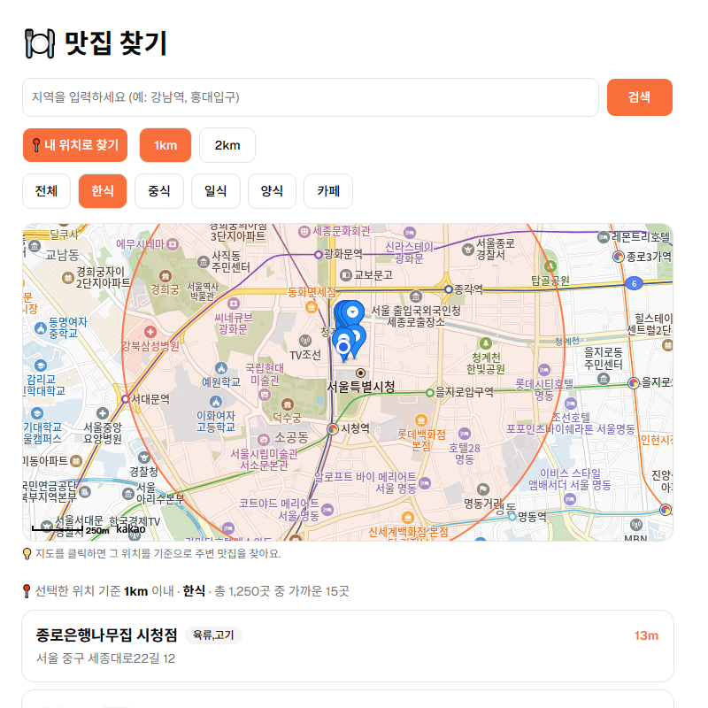

# 🍽️ 맛집 찾기 (matjip-finder)

지역을 검색하거나, **지도를 클릭**하거나, **내 위치**를 기준으로 주변 1km / 2km 안의 맛집을 찾아 지도와 목록으로 보여주는 웹 앱이에요.



## 기능

- **지역 검색** — "강남역", "홍대입구"처럼 지역명으로 맛집 검색
- **내 위치 / 지도 클릭** — 현재 위치 또는 지도에서 직접 고른 지점을 기준으로 **1km / 2km** 반경 안의 가까운 순 탐색
- **카테고리 필터** — 한식 · 중식 · 일식 · 양식 · 카페 (서버에서 거르기 때문에 총 개수·거리순·더 보기가 모두 정확해요)
- **더 보기** — 15개씩, 한 검색당 최대 45개 (카카오 API 한도)
- **지도 ↔ 목록 연동** — 마커나 목록을 누르면 선택한 가게가 지도 위 카드에 표시돼요 (페이지가 스크롤되지 않아요)
- 모바일 화면 대응

## 기술 스택

| 영역 | 사용 기술 |
|---|---|
| 프레임워크 | Next.js 15 (App Router) · React 19 · TypeScript |
| 스타일 | Tailwind CSS 4.1.4 · shadcn/ui (Base UI 기반) |
| 데이터 | [카카오 로컬 API](https://developers.kakao.com/docs/latest/ko/local/dev-guide) |
| 지도 | [카카오맵 JavaScript SDK](https://apis.map.kakao.com/web/) |

## 시작하기

### 1. 설치

```bash
git clone https://github.com/Simon1476/matjip-finder.git
cd matjip-finder
npm install
```

> **Node.js 20.19 이상**을 권장해요. Tailwind는 4.1.4로 **정확히 고정**되어 있는데, 이는 개발 중 Node 20.9에서 Tailwind 4.3+가 실행되지 않았기 때문이에요. Node를 올리기 전에는 Tailwind 버전을 올리지 마세요.

### 2. 카카오 앱 설정

[카카오 개발자 사이트](https://developers.kakao.com)에서 애플리케이션을 만들고 아래를 설정하세요.

1. **앱 키**에서 *REST API 키*와 *JavaScript 키*를 확인
2. **카카오맵(OPEN_MAP_AND_LOCAL) 사용 설정을 ON** — 꺼져 있으면 API가 403을 돌려줘요
3. **플랫폼 > Web > 사이트 도메인**에 `http://localhost:3000` 등록 — 등록하지 않으면 지도가 뜨지 않아요

### 3. 환경변수

`.env.example`을 복사해서 `.env.local`을 만들고 키를 채워 넣으세요.

```bash
cp .env.example .env.local
```

| 변수 | 용도 |
|---|---|
| `KAKAO_REST_API_KEY` | 서버 전용. 맛집 검색(`/api/places`)에서 사용하며 브라우저에 노출되지 않아요 |
| `NEXT_PUBLIC_KAKAO_JS_KEY` | 브라우저용. 지도 표시에 사용해요 |

> ⚠️ `.env.local`은 `.gitignore`에 포함돼 있어요. 키를 커밋하거나 공개된 곳에 붙여 넣지 마세요.

### 4. 실행

```bash
npm run dev     # http://localhost:3000
npm run lint    # 린트
npx tsc --noEmit  # 타입 검사
```

## API

브라우저는 카카오를 직접 부르지 않고 이 앱의 서버(`/api/places`)를 거쳐요. 그래서 REST API 키가 브라우저에 노출되지 않아요.

```
GET /api/places?query=강남역                              # 지역 검색
GET /api/places?x=126.978&y=37.5665&radius=1000          # 반경 검색 (x=경도, y=위도, radius=1000|2000)
GET /api/places?...&category=한식                         # 카테고리 필터 (한식|중식|일식|양식|카페)
GET /api/places?...&page=2                                # 다음 페이지 (1~3)
```

카테고리는 허용 목록으로 검증하며, 목록에 없는 값은 `400`을 돌려줘요. 카페는 카카오 그룹 코드 `CE7`, 나머지는 음식점 `FD6`을 사용해요.

## 프로젝트 구조

```
app/
  page.tsx               검색 조건(위치·반경·카테고리) 관리 + 화면 조립
  api/places/route.ts    카카오 로컬 API 프록시
components/
  KakaoMap.tsx           지도 · 마커 · 반경 원 · 지도 클릭
  SearchBar.tsx          지역 검색창
  LocationControls.tsx   내 위치 버튼 + 1km/2km 토글
  CategoryFilter.tsx     카테고리 토글
  PlaceList.tsx          결과 목록
  PlaceCard.tsx          가게 카드 (목록 · 선택 카드 공용)
  ui/                    shadcn/ui 컴포넌트
hooks/usePlaces.ts       검색 결과 상태와 로직 (검색 · 더 보기 · 선택)
lib/                     카카오 SDK 로더, 위치 가져오기, 타입, 유틸
```

## 참고

- PC에서는 GPS가 없어 "내 위치"가 Wi-Fi/IP 기반으로 추정돼서 수백 m ~ 수 km 오차가 날 수 있어요. 이럴 땐 **지도를 클릭**해서 기준 위치를 직접 정해 보세요.
- 위치 권한은 HTTPS(또는 `localhost`)에서만 동작해요. 휴대폰에서 쓰려면 HTTPS로 배포하고, 그 주소를 카카오 사이트 도메인에 등록해야 해요.

## 라이선스

학습용 개인 프로젝트예요.
